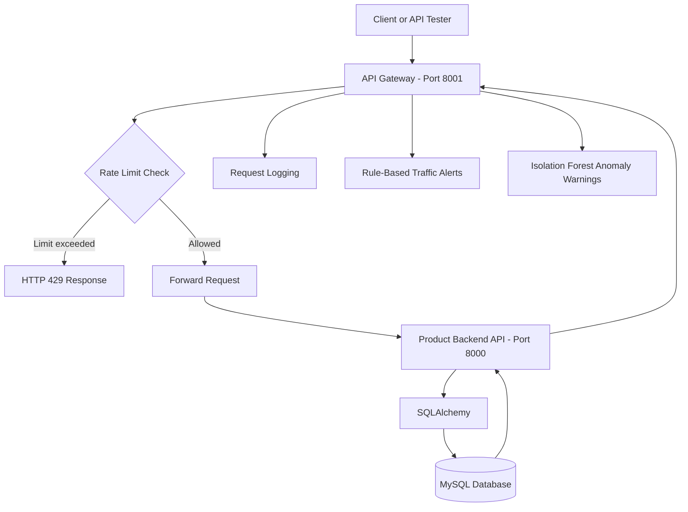

# AI-Powered Rate-Limited API Gateway

A Python-based API gateway that forwards requests to a backend Product API, enforces rate limits, records request logs, detects suspicious traffic patterns using rules, and generates machine-learning-based anomaly alerts.

## Overview

This project explores how an API gateway can act as an entry point between clients and backend services.

Instead of allowing every incoming request to reach the backend without controls, the gateway applies a rate limit, forwards permitted requests, records request information, and analyses traffic patterns for potential anomalies.

The backend manages product operations and stores product data in MySQL. The gateway and backend run as separate FastAPI applications during local development.

## Architecture



## Features

- Product CRUD API backed by MySQL.
- Separate FastAPI gateway and backend services.
- HTTP request forwarding using HTTPX.
- Configurable in-memory rate limiting.
- HTTP 429 responses when the rate limit is exceeded.
- Request logging with HTTP method, path, status code, response duration, and client IP.
- Rule-based alerts for repeated 404 and 5xx responses.
- Isolation Forest-based traffic anomaly warnings.
- Backend timeout and connection-error handling.
- Interactive API documentation through FastAPI Swagger UI.

## Technology Stack

| Technology | Purpose |
|---|---|
| Python | Application programming language |
| FastAPI | Gateway and backend API framework |
| Uvicorn | ASGI server for running the applications |
| HTTPX | Forwarding requests from the gateway to the backend |
| MySQL | Persistent product storage |
| SQLAlchemy | Database models, connections, and sessions |
| PyMySQL | Python MySQL database driver |
| Pydantic | Request data validation and modelling |
| scikit-learn | Machine-learning-based anomaly detection |
| Isolation Forest | Identifying unusual traffic feature patterns |

## Project Structure

```text
API_Gateway_Project/
├── main.py
├── gateway.py
├── database.py
├── db_models.py
├── models.py
├── create_tables.py
├── traffic_analyzer.py
├── traffic_ml_demo.py
├── requirements.txt
├── .gitignore
└── README.md
```

The `myenv/` virtual environment and `__pycache__/` generated files are excluded from source control.

## Prerequisites

- Python 3.12 or a compatible Python version.
- MySQL Server.
- Git, if you want to clone and work with the repository.
- A terminal such as Windows Command Prompt or the VS Code terminal.

## Installation

### 1. Clone the repository

```bat
git clone https://github.com/dd28703/ai-powered-rate-limited-api-gateway.git
cd ai-powered-rate-limited-api-gateway
```

### 2. Create and activate a virtual environment

On Windows Command Prompt:

```bat
python -m venv myenv
myenv\Scripts\activate.bat
```

### 3. Install dependencies

```bat
python -m pip install -r requirements.txt
```

### 4. Configure MySQL

Create the database in MySQL:

```sql
CREATE DATABASE api_gateway_db;
```

The application currently expects a local MySQL server with these settings:

- Host: `localhost`
- Port: `3306`
- Username: `root`
- Database: `api_gateway_db`

Set your own MySQL password as an environment variable in the terminal used to start the backend. Do not commit the real password.

```bat
set "MYSQL_PASSWORD=YOUR_ACTUAL_MYSQL_PASSWORD"
```

Replace the placeholder locally with your actual password. 

Inspect `create_tables.py` and run it if it is the intended table-creation script for your current implementation. Confirm that the required `products` table exists before starting the application.

## Running the Application

Run the backend and gateway in two separate terminals.

### Terminal 1: Product Backend

Activate the virtual environment, set the MySQL password, and start the backend:

```bat
myenv\Scripts\activate.bat
set "MYSQL_PASSWORD=YOUR_ACTUAL_MYSQL_PASSWORD"
uvicorn main:app --reload --port 8000
```

Backend URL:

http://127.0.0.1:8000

Backend Swagger documentation:

http://127.0.0.1:8000/docs

### Terminal 2: API Gateway

From the project directory, activate the virtual environment and start the gateway:

```bat
myenv\Scripts\activate.bat
uvicorn gateway:app --reload --port 8001
```

Gateway URL:

http://127.0.0.1:8001

Gateway Swagger documentation:

http://127.0.0.1:8001/docs

Use the gateway URL when testing gateway behaviour.

## API Endpoints

The gateway forwards supported product operations to the backend.

| Method | Endpoint | Purpose |
|---|---|---|
| GET | `/` | Root endpoint; see implementation |
| GET | `/products` | Retrieve products |
| POST | `/products` | Create a product |
| GET | `/products/{product_id}` | Retrieve one product |
| PUT | `/products/{product_id}` | Update a product |
| DELETE | `/products/{product_id}` | Delete a product |
| GET | `/products/search?max_price=...` | Search products by maximum price |

Confirm route details and response schemas against the current implementation.

### Example: Retrieve products through the gateway

Open:

http://127.0.0.1:8001/products

A successful request returns HTTP 200 when the backend is available and the request is permitted.

### Example: Create a product

Use the gateway's Swagger UI to submit a JSON request to `POST /products`. The request body should follow the current `Product` model:

```json
{
  "name": "Laptop",
  "price": 55000.0,
  "product_id": 101,
  "description": "Example product",
  "quantity": 10
}
```

Use an unused product ID in your database. The example is illustrative; it does not claim that this product already exists.

## Rate Limiting

The gateway currently uses an in-memory rate limiter configured for five requests per client within a rolling 60-second window.

```python
RATE_LIMIT = 5
TIME_WINDOW = 60
```

When a client exceeds the limit, the gateway returns:

```http
HTTP/1.1 429 Too Many Requests
```

This helps limit excessive requests reaching the backend. The current in-memory implementation is local to the running gateway process and is not a distributed rate limiter shared across multiple gateway instances.

## Traffic Monitoring and Anomaly Detection

### Request logging

The gateway records information such as:

- HTTP method
- Request path
- Response status code
- Request duration in milliseconds
- Client IP address

These logs help inspect request flow and diagnose errors.

### Rule-based traffic alerts

The gateway maintains recent response histories and can log warnings for repeated not-found responses and repeated server errors.

These rules generate warnings; they do not constitute a complete security or intrusion-prevention system.

### Isolation Forest anomaly detection

The integrated traffic analyzer uses scikit-learn's Isolation Forest model.

It analyses two features for each client over a 60-second window:

1. Request count.
2. Error response count.

The model is trained on a small, synthetic dataset representing illustrative normal traffic patterns. It predicts whether an observed feature pair appears unusual relative to that training data.

When the model predicts an anomaly, the gateway logs an ML anomaly warning.

**Important limitations:**

- The training data is synthetic and limited.
- The model has not been evaluated on a representative, labelled real-world traffic dataset.
- No production-level accuracy, precision, recall, or false-positive rate has been established.
- ML alerts are logged as warnings; the ML detector does not independently block traffic.
- The rate limiter is a separate mechanism responsible for rejecting excessive requests.

The standalone `traffic_ml_demo.py` file demonstrates the model separately from the gateway integration.

## Testing and Observed Results

The following behaviours have been manually tested during local development:

- Gateway startup and access to Swagger documentation.
- Successful forwarding of product requests to the backend.
- HTTP 200 responses for successful product retrieval.
- HTTP 429 responses after exceeding the configured rate limit.
- Request logs containing method, path, status, duration, and client IP.
- Rule-based warnings for repeated 404 responses.
- HTTP 502 responses and repeated server-error warnings when the backend was temporarily unavailable.
- ML anomaly warnings during a direct simulated-traffic test.
- ML anomaly warnings in gateway logs during an earlier end-to-end test.

These are observed manual checks, not a formal benchmark or a claim of automated test-suite coverage. ML detection quality has not been measured with accuracy or precision metrics.

## Limitations

- Rate-limit counters and traffic histories are stored in memory.
- State resets when the relevant process restarts.
- Counters are not shared across multiple gateway instances.
- The ML model uses a small synthetic training dataset.
- Anomaly alerts do not automatically block suspicious clients.
- Local MySQL configuration is required to run the backend.
- The project has been tested locally; production deployment has not been established.

## Future Improvements

Potential next steps include:

- Add automated API and integration tests.
- Improve ML evaluation using representative, labelled traffic data.
- Measure precision, recall, and false-positive rates before making detection claims.
- Add persistent or shared rate-limit storage if multiple gateway instances are introduced.
- Add authentication and authorization where required.
- Improve structured logging and configuration management.
- Add deployment instructions after testing an actual deployment environment.

## Learning Outcomes

This project helped me to explore backend API design, HTTP request forwarding, database persistence, rate limiting, request logging, rule-based monitoring, and a basic ML anomaly-detection integration.

The goal is to demonstrate the design and behaviour of a working local prototype while being transparent about its limitations.
